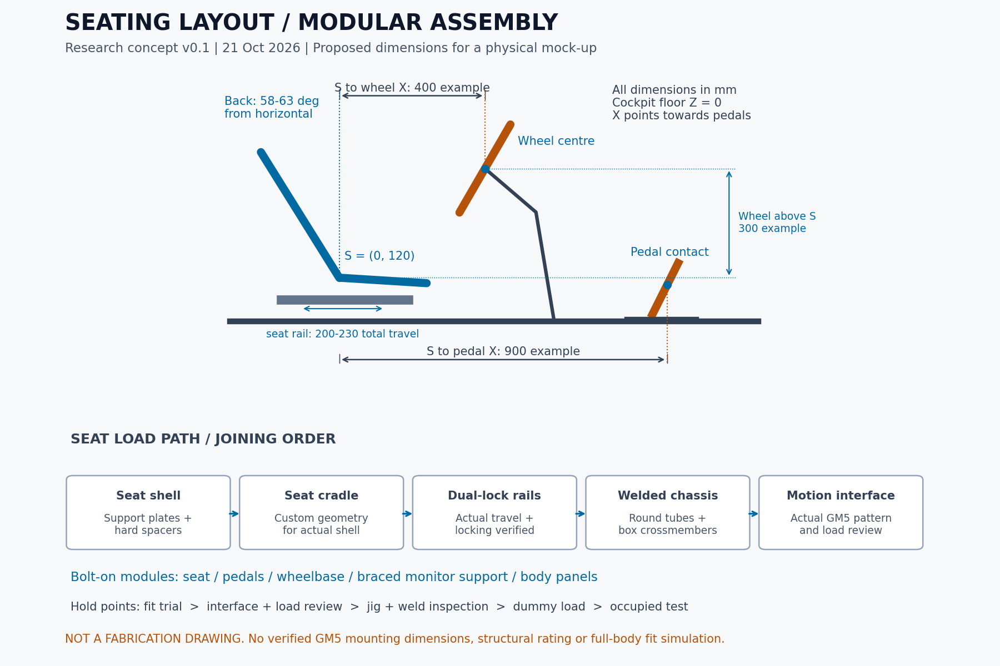

# ข้อมูลตั้งต้นสำหรับ Mark: ท่านั่ง วัสดุ และการประกอบ

วันที่ศึกษา 21 ตุลาคม 2026 (Asia/Bangkok) — ร่างวิศวกรรมเบื้องต้น v0.1 สำหรับวาง layout/mock-up อ่านร่วมกับ [Context หลัก](../Gokart_IDEA/PROJECT_CONTEXT.md) และ [แผนพร้อมโชว์](show-ready-plan-th.md)

ผู้ใช้มอบหมายให้หาขนาดท่านั่ง วัสดุ และวิธีประกอบ ยังไม่ได้เลือกวัสดุหรืออนุมัติแบบผลิต ตัวเลขที่ระบุว่า **เสนอ** เป็นสมมติฐานออกแบบของโครงการ ต้องตรวจด้วยคน อุปกรณ์จริง และโหลด ไม่ใช่มิติจากภาพที่วัดได้หรือพิกัดรับรอง

## 1. ข้อเสนอที่นำไปวางแบบได้

ใช้โครงหลักเหล็กเชื่อมที่มีคานรับเบาะ/แป้น/พวงมาลัยและจุด Motion อยู่บนเส้นทางแรงร่วมกัน จัดรูปทรงภายนอกด้วยท่อกลม ชุดเบาะ แป้น พวงมาลัย ขาจอ และตัวถังยึดด้วยสลักเกลียวเพื่อปรับ/ถอดได้ โครงหลักหนึ่งชิ้นในเครื่องแรกช่วยลดรอยต่อที่ต้องตรวจ ยังไม่เสนอแยกกลางโครงหลักจนกว่าจะจำเป็นจากการขนย้ายและมีแบบรอยต่อที่ตรวจแล้ว

ตั้งต้นศึกษา **ท่อกลม OD 34.0 × 2.3 มม. + คานกล่อง 40 × 40 × 2.3 มม.** และเพลตเฉพาะจุด ไม่ใช่ใช้ท่อขนาดเดียวทุกตำแหน่ง ขาจอมีค้ำเข้าฐานและถอดได้ ตัวถังกับล้อแต่งรับน้ำหนักตนเอง ไม่ใช้เป็นส่วนรับผู้ขับหรือจุดยก

ไฟล์ [SVG](assets/seating-layout-v01.svg) และ [ตารางบันทึก mock-up](seating-mockup-measurements.csv) ใช้ประกอบการคุยแบบ ภาพนี้ไม่ใช่รูปคนจำลองทางสรีระ และไม่แสดงระยะติดตั้ง GM5 จริง

## 2. สิ่งที่ตรวจจากต้นทางแล้ว

| หลักฐาน | ข้อมูลที่ใช้ | ข้อจำกัด |
|---|---|---|
| [Tony Kart Racer 401 T — ผู้ผลิต](https://www.tonykart.com/telai-racer-401T_en.php) | ฐานล้อ 1,045 มม. โครงท่อ 30 มม. วัสดุ molybdenum chrome steel | ฐานล้อไม่ใช่ความยาวรถ ไม่ได้ระบุความหนาท่อในหน้านี้ และไม่ใช่สเปกที่เลือกให้ simulator |
| [Tillett T11 — ผู้ผลิต](https://tillett.co.uk/t11/) | เบาะฐานแบน พนักที่ผู้ผลิตระบุ 58° น้ำหนักตัวอย่างประมาณ 1.4 กก. มีหลายไซซ์ | เป็นข้อมูลสินค้า ไม่ได้ยืนยันว่ารองรับผู้ใช้ทุกคนหรือยึดลง slider ได้โดยตรง |
| [Tillett dimensions 2024](https://tillett.co.uk/wp-content/uploads/2025/12/Kart-seat-dimensions-2024.pdf) | ดูตารางและภาพนิยาม A/B/C/D/E แล้ว หน่วยต้นทางเซนติเมตร; A วัดตรงสัมผัสกระดูกสะโพก ไม่ใช่จุดแคบสุด | ต้องเผื่อรูปทรงจริง จุดยึด และโฟม ไม่เลือกเบาะจากน้ำหนัก/ส่วนสูงเพียงอย่างเดียว |
| [Tillett positioning 2025](https://tillett.co.uk/wp-content/uploads/2025/12/Kart-seat-positioning-2025.pdf) | จุดยึดต้องแนบผิว ใช้ spacer แข็งให้พอดี ไม่ดึงเปลือกเบาะให้บิด; เตือนเรื่อง spacer ยางและหัวน็อตใกล้ซี่โครง | ระยะเบาะเทียบเพลามีไว้จัดสมดุลรถแข่ง ไม่ยกมาเป็นตำแหน่ง Motion โดยตรง |
| [SODI RT10 — ผู้ผลิต](https://www.sodikart.com/en-gb/karts/rental/rt10-42.html) | มีการปรับทั้งเบาะและแป้น; แป้นปรับระยะและความสูงได้ | เป็นหลักฐานแนวคิดการรองรับหลายสรีระ ไม่ใช้กลไกสิทธิบัตรมาเป็นแบบผลิต |
| [Sabelt slider — ผู้ผลิต](https://sabeltamerica.com/products/slider-system) | ตัวอย่างรางเลื่อน 230 มม. ล็อกสองข้าง ใช้กับ bottom mount | ไม่ใช่การเลือกยี่ห้อหรือรับรองกับ Motion; เปลือกเบาะโกคาร์ทต้องมี cradle ที่ออกแบบเฉพาะ |
| [Pacific Pipe catalogue 2025](https://www.pacificpipe.co.th/files/download/catalog_pap_%E0%B9%80%E0%B8%A5%E0%B9%88%E0%B8%A1%E0%B9%80%E0%B8%A5%E0%B9%87%E0%B8%81_2025_final%20%28resize%29_2.pdf) | อ่าน PDF จากผู้ผลิต: มีท่อกลม 34.0 × 2.3 และกล่อง 40 × 40 × 2.3 มม.; ตารางมาตรฐานแยก STK400/JIS G3444 กับ STKR400/JIS G3466 | แค็ตตาล็อกไม่ยืนยันสต็อก เกรดของสินค้าทุกความหนา หรือผลทดสอบชิ้นงานที่จะซื้อ ต้องระบุเกรด/มาตรฐานและขอใบรับรองล็อต |
| [GM5 Assembly & User Manual](https://file.thermaltake.com/file/qig/GM5_User_Manual.pdf) | ดาวน์โหลดและตรวจภาพครบ 4 หน้า PDF (เอกสารพับ มีเลขพิมพ์ 1–6): ชุด actuator 4 ตัว connector 4 ชุด และตัวอย่างยึดกับราง cockpit ด้วย M8 | ภาพขั้นตอนสำหรับ cockpit อ้างอิง ไม่ให้มิติรู/torque/พิกัดจุดยึดสำหรับโครงเหล็กใหม่ |

## 3. ขนาดท่านั่งสำหรับ mock-up — ข้อเสนอ

**ระบบอ้างอิง:** พื้นบน cockpit คือ Z=0; X ไปด้านแป้น; Y ไปซ้ายผู้ขับ จุด S คือรอยต่อบริเวณรองก้นกับพนักบนแนวกึ่งกลางผิวสัมผัสของเบาะที่ติดตั้งจริง ตั้ง S ที่ X=0 ในตำแหน่งรางกลาง จุดนี้เป็น datum ของงาน ไม่ใช่ H-point ทางสรีรศาสตร์หรือจุดหมุนสะโพกที่วัดแล้ว ระยะ S–อุปกรณ์วัดใหม่ทุกครั้งที่เลื่อนเบาะ

| รายการ | ช่วงเริ่มลองที่เสนอ | วิธีเลือกค่าจริง |
|---|---|---|
| ขอบเขตคน | ส่วนสูง 150–190 ซม.; เป้าหมายน้ำหนักไม่เกิน 120 กก. | เก็บความยาวขา ลำตัว สะโพกและรองเท้าด้วย ไม่ยืนยัน fit หรือโหลดจากส่วนสูงอย่างเดียว |
| แนวพนัก | เริ่ม 58–63° จากแนวนอน หรือเอนหลัง 27–32° จากแนวดิ่ง | อิงลักษณะ T11; นิยามมุมนี้เป็นของ layout ต้องวัด shell จริง ไม่ใช่มุมก้น–พนักหรือปรับเบาะด้วยการดึงเปลือก |
| Z ของ S เหนือพื้น cockpit | 100–160 มม.; ตัวอย่าง 120 | รวมความสูง cradle/slider จริง; ไม่ใช่ความสูงเบาะจากพื้นห้อง ต้องบวกโครง/ฐาน/ตำแหน่ง Motion |
| รางเบาะ | ระยะใช้งานรวม 200–230 มม. ล็อกสองข้าง | ทดลองสองปลายรางกับทุกไซซ์ ตรวจเข่า สาย และพื้นที่ขึ้นลง |
| S ถึงจุดสัมผัสหน้าแป้นในแนว X | เริ่มลองประมาณ 800–1,000 มม. สำหรับตำแหน่งที่ปรับเข้ากับคนนั้น | ตัวอย่างเริ่มที่ 900; จุดสัมผัส/มุมหน้าแป้นจริงและความยาวรองเท้าเปลี่ยนระยะนี้ ต้องไม่เหยียดเข่าตึงเมื่อเหยียบสุด |
| ชุดแป้นเลื่อน | เผื่อช่วงทดลองประมาณ 150 มม. | ช่วงรางเบาะกับช่วงแป้นรวมกันไม่ใช่หลักฐานว่ารองรับคนครบช่วงแล้ว |
| S ถึงศูนย์กลางวงพวงมาลัยในแนว X | เริ่มลอง 350–450 มม.; ตัวอย่าง 400 | ให้ไหล่พิงและแขนงอเมื่อจับ 9/3 นาฬิกา ลองหมุนสุดโดยไม่ชนต้นขา; ทิศทางวง/quick release/ความลึกวงมีผล |
| ศูนย์กลางวงสูงกว่า S | เริ่ม 250–350 มม.; ตัวอย่าง 300 | ร่วมปรับระดับและมุมฐาน ไม่ตั้งค่าจากส่วนสูงอย่างเดียว |
| การปรับชุดพวงมาลัย | เผื่อหน้า–หลังรวม 100 มม. สูง–ต่ำรวม 100 มม. | ออกแบบ plate/ช่วงปรับให้ยึดแน่นและซ่อนจุดหนีบ ล็อกก่อนเปิด Motion |
| วงพวงมาลัย | ลองเส้นผ่านศูนย์กลาง 300–320 มม. | กรอบทดลอง ไม่เลือกรุ่น/ยี่ห้อ ต้องตรวจแรง FFB และการเอื้อมกับฐานที่หัวหน้าเลือก |
| แป้นซ้าย–ขวา | เริ่มระยะศูนย์กลางจุดสัมผัสเท้า 320–400 มม. | ลองความกว้างสะโพก/แนวเข่าและช่องผ่านเสาพวงมาลัย; ห้ามฝืนแยกแป้นที่ผู้ผลิตไม่รองรับ |
| ขอบช่องเบาะ/การติดตั้ง | เผื่อช่องประกอบประมาณ 520–560 มม. ก่อนวัด shell จริง | นับหัวน็อต/เครื่องมือและ cradle เพิ่มจากความกว้างเบาะภายใน |
| ช่องเข่าถึงชิ้นส่วนแข็ง | ตั้งเป้าเริ่ม ≥50 มม. ในทุกท่าที่ทดสอบ | เป็นระยะเสนอ ไม่ใช่มาตรฐานหรือระยะป้องกันหนีบที่รับรอง ต้องตรวจตลอดการหมุน/เหยียบ/ปรับ |

มิติรถตั้งต้นสำหรับ block model: ยาวประมาณ **1,700–1,850 มม.** กว้างรวมล้อ/ตัวถังประมาณ **1,200–1,350 มม.** ไม่รวมระยะกวาดของ Motion/ทางเดินและชุดจอ เป็นกรอบประมาณการของโครงการ ไม่ได้อนุมานจากฐานล้อ 1,045 มม. หรือใช้มิติ GM5 520 × 485 มม. เป็น footprint รถ

จอ: ใช้กรอบจอตัวอย่าง 615 × 365 มม./ตัว; หากหมุนจอข้าง 45–55° จากระนาบจอกลาง ความกว้างฉายของสามจอประมาณ 615 × (1 + 2 cos θ) = 1,320–1,485 มม. ก่อนขาจอ/ระยะเว้น ตั้งพื้นที่ layout ชุดจอประมาณ 1,500–1,700 มม. แล้วแทนด้วยรุ่นจริง ระยะตาถึงจอและ FOV ต้องเลือกจากท่านั่งและความสามารถเกม ไม่ล็อกมุมจอจากภาพอย่างเดียว

### ตัวอย่างขนาดเบาะเพื่อเลือกตัวลอง

ค่าด้านล่างแปลงจาก Tillett T11 เป็นมิลลิเมตร (ไม่ใช่แบบ cradle):

| ไซซ์ | A บริเวณสะโพก | B บริเวณลำตัว | C ความกว้างปากด้านหน้า |
|---|---:|---:|---:|
| ML | 325 | 360 | 460 |
| L | 350 | 375 | 455 |
| XL | 355 | 385 | 470 |
| XXL | 385 | 405 | 500 |

ช่วง 150–190 ซม./120 กก. ไม่รับประกันว่าจะใช้ shell เดียวได้กับทุกคน เสนอเริ่ม shell ที่ลองกับคนตัวใหญ่ได้ร่วมกับ insert โฟมแน่นถอดเปลี่ยนสำหรับคนเล็ก แต่หากโฟมหนาจนตำแหน่ง/การยึดไม่เหมาะต้องใช้เบาะคนละไซซ์หรือจำกัดผู้ใช้ตามผลจริง ไม่กำหนดเบาะจากขนาดกางเกงอย่างเดียว

### วิธีทำ mock-up ก่อน CAD รายละเอียด

1. ทำแท่นทดลองที่มั่นคง ไม่ต่อ Motion ใช้เบาะจริงหรือ shell ขนาดจริง พร้อมฐานแป้น/วงปรับได้ ติดสเกล X/Z และวัดมุมพนัก
2. ให้คนใกล้ 150/170/190 ซม. ทดลองอย่างน้อย 5 คนตามแผนพร้อมโชว์ บันทึกสรีระทุกคน ช่วงที่ยังหาคนไม่ได้ให้ระบุรอทดสอบ
3. ปรับเบาะและแป้นก่อน ตามด้วยพวงมาลัย แล้ววัด S–แป้น/S–วงที่ใช้งานได้จริง ทดสอบเหยียบสุด หมุนวง ลุกเข้าออก และมองจอโดยไหล่ไม่ต้องหลุดจากพนัก; การทดลองแรกไม่ใช้แรงเบรก/FFB สูง
4. ถ่ายด้านข้าง/หน้า/บนพร้อมสเกล เก็บค่าคนตัวเล็กและใหญ่ที่ใช้งานได้ ไม่เอาค่าเฉลี่ยคนเดียวไปล็อกแบบ
5. ส่ง Mark ทำ block CAD พร้อม envelope ร่างกาย/อุปกรณ์และช่วงปรับ แล้วให้ Chin ตรวจกล่อง สาย จุดต่อและเครื่องมือเข้าถึง ก่อนเลือกแนวท่อสุดท้าย

## 4. วัสดุเสนอและหน้าที่

ขนาดทั้งหมดเป็น **ตัวเลือกตั้งต้นให้คำนวณและทดลอง** ไม่อนุมัติรับน้ำหนัก 120 กก. ด้วยการเลือกความหนาจากตารางนี้

| ส่วน | วัสดุ/ขนาดเริ่มศึกษา | เหตุผลและเงื่อนไข |
|---|---|---|
| ท่อหลักรอบ cockpit | เหล็กคาร์บอนท่อกลม JIS G3444 STK400, OD 34.0 × 2.3 มม. | รูปลักษณ์ใกล้โกคาร์ทและมีขนาดในแค็ตตาล็อกไทย; ตรวจเกรดจริง ความหนา แนวตะเข็บและแม่พิมพ์ดัด |
| คานใต้เบาะ แป้น และเชื่อมจุด Motion | ท่อกล่อง JIS G3466 STKR400, 40 × 40 × 2.3 มม. | ผิวเรียบต่อเพลตง่าย เพิ่มค้ำใกล้จุดแรง; ขนาดสุดท้ายขึ้นกับ span/โหลด/การบิด |
| แท่นวง/แป้นและ gusset | เพลตเหล็ก SS400 เริ่ม 4–6 มม. ใช้พับขอบ/ค้ำ | เพลตแบนยาวอาจโก่งแม้หนา ต้องตรวจช่วงยื่นและแรงเบรก/แรงบิดจริง |
| Adapter Motion | เริ่มศึกษาเพลตเหล็ก 6–8 มม. พร้อมคานรอง/ค้ำ | ห้ามตีความเป็นแบบจุดยึด GM5 ที่ผ่านแล้ว ต้องวัด pattern, แนวแรง และความหนาที่ผู้ตรวจคำนวณ |
| ขาจอถอดได้ | เริ่มกล่องเหล็ก 40 × 40 × 2.3 มม. ค้ำสองระนาบ แขนสั้นเท่าที่ layout ยอม | รองรับจอจริง/แขนยื่นและโหลดซ้ำ ตรวจการสั่น/ความล้า; ถอดที่รอยต่อซึ่งเข้าถึงน็อตได้ |
| พื้น | Aluminium 5052-H32 เริ่ม 2–3 มม. ยึดกับคานถี่และแผ่นกันลื่น | [Atlas datasheet](https://atlassteels.com.au/wp-content/uploads/2021/08/Aluminium-Alloy-5052-Data-Sheet-24-06-21.pdf) แสดงงานแผ่น/พื้นและคุณสมบัติ; เสนอช่วงคาน 200–250 มม. เพื่อเริ่มตรวจแรงเหยียบ ยังไม่ใช่พิกัดรับน้ำหนักหรือพื้นยืนที่รับรอง |
| Cradle เบาะ | เพลต/แถบเหล็กขึ้นรูปเริ่ม 3–4 มม. พร้อมค้ำและ support plates ตาม shell | ต้องรองตามผิวไม่บิด shell ไม่ขันรางเข้ากับเปลือกไฟเบอร์แบน ๆ โดยตรง |
| ตัวถัง/ฝาครอบ | เสนอ ABS หรือ PC/ABS ขึ้นรูป 3–4 มม.; ไฟเบอร์กลาสเป็นตัวเปรียบเทียบ | [SIMONA PMC](https://simona-pmc.com/pc-abs/) มีวัสดุสำหรับ thermoforming; ขนาดเสนอขึ้นกับรูปทรง/แม่พิมพ์ งานโชว์ต้องตรวจความร้อน การติดไฟตามสถานที่ และขอบคม |
| งาน H2C | PETG/ASA ตามลักษณะชิ้นงาน เช่น ต้นแบบรูปร่าง ฝาตกแต่ง ป้ายและไกด์สาย | เสนอใช้ช่วย fit/ทำแม่แบบ ไม่ใช้เป็นขารับผู้ขับ จุดยึด Motion/จอ/FFB หรือชิ้นที่อุณหภูมิ/โหลดทำให้เสียรูปโดยยังไม่ทดสอบ |

**เหตุผลที่เริ่มจากเหล็กคาร์บอน:** ลดความซับซ้อนการจัดหา/เชื่อมต้นแบบ และคงรูปท่อที่ผู้ใช้ต้องการ โครง chromoly แบบรถแข่งต้องมีเกรดและกระบวนการเชื่อมที่เหมาะสม ไม่ได้แปลว่าย้ายมาใช้กับ Motion แล้วจอสั่นน้อยลงโดยอัตโนมัติ ส่วน aluminium เชื่อม/โปรไฟล์ยังเป็นทางเลือกหากมีเหตุผลด้านน้ำหนักและตรวจรอยต่อได้ ไม่ใช่การเปลี่ยนแนวทางที่เลือกแล้ว [Hydro](https://www.hydro.com/globalassets/01-products--services/extruded-profiles/americas/ena-resources/alloy-data-sheets/hydro_2019_data_sheet_6082_revise_1.pdf) ระบุการเชื่อมลดกำลังบริเวณรอยเชื่อมของ 6082 จึงไม่ใช้ค่า T6 เดิมกับบริเวณเชื่อมโดยไม่ตรวจ

STK400/STKR400 เป็นเกรดท่อ ส่วน SS400 เป็นสเปกเหล็กแผ่น/รูปพรรณตามที่สั่ง ไม่ใช้ชื่อแทนกันโดยไม่มีใบรับรอง และคำว่าท่อดำ/ขนาดนิ้วไม่เพียงพอ ต้องระบุ OD × ความหนา × เกรด × มาตรฐานจริง เช่นท่อ nominal 1 นิ้วในตารางที่เลือกมี OD 34.0 มม. ไม่ใช่ OD 25.4 มม.

### น้ำหนักตั้งต้นเฉพาะโครง

Pacific Pipe ระบุท่อกลม 34 × 2.3 ประมาณ **1.80 กก./ม.** (เลขพิมพ์ 16–17 / PDF หน้า 9) และกล่อง 40 × 40 × 2.3 ประมาณ **2.62 กก./ม.** (เลขพิมพ์ 24 / PDF หน้า 13)

ตัวอย่าง budget วัสดุ ไม่ใช่ cut list: ท่อกลม 6–8 ม. = 10.8–14.4 กก.; กล่อง 3–4 ม. = 7.86–10.48 กก.; เพลต/ค้ำ/ชิ้นเชื่อมเผื่อ 4–8 กก. รวม **22.7–32.9 กก.** ก่อนยืนยัน CAD และชั่งจริง ใกล้กรอบเดิมโครง 25–35 กก. แต่ไม่ได้พิสูจน์ว่าจุดยึดแข็งแรงหรือโครงทำได้ตามมวลนี้ ไม่รวมขาจอ รางเบาะ พื้น/ตัวถัง อุปกรณ์ และคน

คำนวณหน้าตัดอุดมคติเพื่อเทียบเฉพาะท่อตรง: I ของท่อกลม 30 × 2 ≈17,329 มม.^4; 34 × 2.3 ≈28,923 มม.^4 (ประมาณ 1.67 เท่า) จาก I=π(D^4−d^4)/64 ไม่ใช่กำลังรับโหลดทั้งโครงและไม่รวมความบาง/ความรีจากการดัด รอยเชื่อม รอยต่อ หรือความล้า ใช้ค่าจริงของวัสดุ/หน้าตัดในการวิเคราะห์ต่อ

## 5. โครงสร้างโมดูลและเส้นทางแรง

| โมดูล | วิธีประกอบเสนอ | เส้นทางแรง/จุดต้องตรวจ |
|---|---|---|
| A โครงหลัก | ดัดท่อ/เข้าปากท่อ เชื่อมบนจิ๊กพร้อมคานกล่อง | จุดรับ Motion ผูกกับคานหลัก ไม่ยึดกับท่อแต่งหรือแผ่นพื้นบาง |
| B เบาะ | shell → support plate/spacer แข็ง → cradle → รางคู่ล็อกสองข้าง → คานโครง | ตรวจแรงก้ม/บิดและความสูงที่เพิ่มจาก slider; จุดยึด shell ตามข้อกำหนดผู้ผลิต |
| C พวงมาลัย | ฐาน FFB → adapter เปลี่ยนรุ่นได้ → แท่นปรับมีค้ำสองด้าน → โครง | ลดช่วงยื่น ตรวจแรงบิดและแรงดึงผู้ขับ; ไม่ใช้ตัวถังรับแรง |
| D เบรกซ้าย/คันเร่งขวา | แป้นแยกบน carrier เดียวที่เลื่อนและล็อกได้ → คานสองข้าง | รักษาระยะซ้าย–ขวาขณะปรับ ลดบิดจากแรงเบรกด้านเดียว; Active ต้องตรวจ clearances/สายและพิกัดจริง |
| E ขาจอ | เสาหลักมีค้ำ → แผ่นหน้าแปลน/จุดระบุตำแหน่ง → คาน/แขนจอ → VESA | ตรวจน้ำหนักและแขนยื่นที่ทำให้เกิดโมเมนต์ โหลดซ้ำและความสั่น; ไม่วางใกล้จุดเข้าออกจนคนเผลอจับยก |
| F ตัวถัง/พื้น/ล้อ | ขันกับหูยึดแยก ถอดเข้าซ่อมได้ | พื้นต้องรับแรงเหยียบตามแผน แต่ตัวถัง/ล้อไม่เป็นทางส่งแรง Motion; ล้อไม่ค้ำพื้นตลอดช่วง Motion เว้นแต่ออกแบบให้ทำหน้าที่นั้น |
| G ชุด GM5 | ใช้ interface/แนวติดตั้งที่ผู้ผลิตรองรับ แล้วทำ adapter เข้าคาน | ตรวจจากเครื่องจริง ห้ามสลับตำแหน่ง/กลับด้านเสาจากภาพแนวคิดโดยสมมติว่าทำได้ |

**หลักรอยต่อ:** เชื่อมแกนหลักในโรงงาน ขันโมดูลตอนประกอบ/ขนย้าย แนวทาง [Steel Tube Institute](https://steeltubeinstitute.org/resources/hss-splices/) ใช้หลักเดียวกันกับ HSS แต่ตัวอย่างอาคารไม่ใช่แบบคำนวณของ simulator

- รอยต่อรับแรงใช้สลักเกลียวตามขนาด/เกรดที่ตรวจแล้ว เริ่มจัดแบบรอบ M8/M10 ได้ แต่จำนวน เกรด ความยาวจับ เกลียวกินและ torque ต้องคำนวณ/อิงผู้ผลิต ไม่ตั้งแรงขันค่ากลางให้ทุกจุด
- ถ้าขันทะลุผนังท่อบาง ให้พิจารณา crush sleeve/เพลตรองที่ออกแบบแล้ว ไม่บีบผนังท่อจนยุบ; จุดที่เข้าเครื่องมือไม่ได้ให้ปรับหูยึด/แผ่นต่อก่อนปิดโครง ดู [STI Bolting to HSS](https://steeltubeinstitute.org/resources/bolting-hss-members/)
- รูรีมีไว้ปรับ แต่จุดที่รับแรงซ้ำต้องตรวจการลื่นและมีวิธีอ้างอิง/หยุดตำแหน่งที่เหมาะสม ไม่ใช้รูรีกับน็อตตัวเดียวโดยไม่มีแบบตรวจ
- ใช้น็อตล็อก/วิธีล็อกเกลียวตามข้อกำหนดจุดนั้น ทำ torque record และ witness mark สำหรับตรวจการเคลื่อน เครื่องหมายสีไม่ได้ป้องกันการคลายเอง
- เบาะใช้ spacer แข็งที่ขนานผิวและ support plates ตามผู้ผลิต ไม่ใช้ยางอ่อนคั่นจุดรับแรงของ shell; แผ่นรองสั่นอาจใช้กับตัวถังเฉพาะที่ไม่ทำให้ทางส่งแรงหรือจุดต่อไฟฟ้าเสียหน้าที่
- พื้น aluminium ต่อโครงเหล็กด้วยสลักเกลียวและวิธีป้องกันกัดกร่อนที่รอยสัมผัส งาน bonding/สายดินให้ Chin กำหนดจุดเฉพาะ ไม่พึ่งการสัมผัสผ่านสีหรือแผ่นฉนวน

## 6. ลำดับผลิตและประกอบเสนอ

1. **ยืนยัน interface:** วัดเบาะ ราง ฐาน FFB/แป้น จอ และ GM5 หรือใช้ envelope รุ่นตัวเลือกที่หัวหน้าจะพิจารณา ทำรายการมิติที่ยังไม่มี ห้ามปล่อยรูยึดถาวรตามรูปเว็บ
2. **Mock-up และ block CAD:** ทำขั้นตอนท่านั่งข้างต้น ใส่มวลแต่ละโมดูล ทำ full-motion envelope และตรวจทางขึ้นลง/ขนย้าย พร้อมผังสายจาก Chin
3. **ตรวจแบบ:** ตรวจแรงผู้ขับ/เบรก/FFB/จอ/Motion และความล้า จุดต่อ/รอยเชื่อม/ท่อบาง รวมถึงโหลดเยื้องและหยุดฉุกเฉิน กำหนดแนวเชื่อม เกณฑ์ตรวจ และแผนทดสอบก่อนผลิต
4. **ทำจิ๊ก:** โต๊ะเรียบ มีแนวกลาง/ระนาบอ้างอิง ตัวหยุดตำแหน่ง และ locator จุด Motion/เบาะ/ขาจอ; หลีกเลี่ยงล็อกทุกทิศจนชิ้นงานหดตัวไม่ได้ จัดช่องให้เชื่อม/วัด/ถอดออกได้
5. **เตรียมท่อ:** ยืนยัน OD/ความหนา/grade กับแม่พิมพ์ดัด กำหนด centerline radius ตามเครื่องมือจริงและทดลองชิ้นแรก ตรวจรอยย่น/แบน/ความหนาหลังดัด; เข้าปากท่อให้แนบ ลบคมและทำความสะอาดผิว
6. **เชื่อมโครง:** เสนอ MIG/MAG กับเหล็กคาร์บอนโดยช่าง/กระบวนการที่เหมาะกับความหนา; tack แล้ววัด ซ่อม tack ที่เสียก่อนเชื่อมจริง สลับตำแหน่งตามแผนลดบิด ตรวจหลังเย็นและเมื่อปลดจิ๊ก ไม่ใช้คำแนะนำสำหรับท่อแรงดันเป็น WPS โดยตรง [Miller](https://www.millerwelds.com/fr-ca/resources/knowledge-hub/field-welding/pipe/pipe-welding-techniques-to-avoid-9-common-issues) อธิบายผลของ fit-up/สิ่งปนเปื้อน/tack ต่อคุณภาพรอยเชื่อม; ไม่กำหนดกระแส/ลวด/ก๊าซโดยไม่มี joint trial
7. **ประกอบแห้งก่อนสี:** ใส่ทุกโมดูล ตรวจเส้นทแยง/ระนาบติดตั้ง/ความขนานราง/การถอดเครื่องมือ และ trial fit จุดยึดจริง แก้ปัญหาก่อนทำสี ห้ามเจียรแนวเชื่อมรับแรงเพื่อความสวยโดยไม่ตรวจ
8. **ทำผิวและประกอบสุดท้าย:** แยกชิ้น ทำความสะอาด/รองพื้น/สีหรือ powder coat ตามกระบวนการโรงงาน ปิดเกลียวและผิวอ้างอิงที่ต้องคุม fit กำหนดจุดสายดินแยก ชั่งมวลแต่ละโมดูล บันทึกแรงขันและเดินสายที่ไม่ตึง/หนีบ
9. **ทดสอบก่อนคน:** ตรวจงานเชื่อมและมิติตามแบบ ทดสอบโหลดจำลอง/การหยุด/ระยะเคลื่อน/สายตามแผนที่ตรวจแล้ว จากนั้นจึงทดลองคนและปรับ Feeling
10. **เตรียมโชว์:** ผ่านเกณฑ์ A01–A16 รวมจอสั่น endurance ขนย้ายและตั้งคืน ออกแบบ as-built/BOM/คู่มือและลงชื่อปล่อยเครื่องโดยผู้ที่แต่งตั้ง

สำหรับงานจิ๊ก เสนอเป้าความต่างเส้นทแยงโครงไม่เกิน 2 มม. และตำแหน่งจุดต่อโมดูลหลัก ±1 มม. เพื่อเริ่มคุยโรงงานเท่านั้น ต้องตรวจ tolerance stack และรูจริงก่อนใช้เป็นเกณฑ์ตรวจรับ ความขนานรางและระนาบจุด Motion ใช้ข้อกำหนดอุปกรณ์/แบบตรวจแล้ว ไม่เหมารวมตามสองตัวเลขนี้

## 7. ข้อมูล GM5 ใหม่ที่กระทบแบบและการโชว์

ตรวจคู่มือภาพได้แล้วเมื่อ 21 ต.ค. แทนสถานะเดิมที่เปิด PDF ไม่สำเร็จ:

- ใน Assembly Recommendations (เลขพิมพ์ 1 / PDF หน้า 2) ระบุ **เมื่อโหลดรวมเกิน 200 กก. ให้จำกัดการเล่นต่อเนื่องไม่เกิน 4 ชั่วโมง** เพื่อลดการตอบสนองช้าลงและการสึกหรอ ไม่ได้ระบุระยะพักหรือยืนยันการใช้ซ้ำทั้งวัน
- ถ้า cockpit ที่ถูกยกทั้งหมด 85–135 กก. ร่วมกับผู้ขับ 120 กก. จะเป็น 205–255 กก. ก่อนแจกแจงส่วน GM5/ฐานอื่น จึงอาจเข้าข้อจำกัดนี้ แม้ payload หน้าเว็บ 300 กก. ไม่ได้หมายความว่าโชว์ต่อเนื่องทั้งวันได้
- ต้องชั่ง/แยกมวลเคลื่อนจริง ตรวจ duty cycle และช่วงพักที่ผู้ผลิตยอมรับก่อนกำหนดตารางโชว์ การซ้อมวันโชว์ 8 ชม. หมายถึงช่วงกิจกรรมรวมการพัก ไม่ใช่สั่งเคลื่อน 8 ชม. ต่อเนื่อง
- คู่มือมี connector และตัวอย่าง M8 แต่ยังไม่มีมิติ interface ให้ทำแบบโครงใหม่ ต้องวัดของจริง/หา drawing และตรวจเงื่อนไขติดตั้งก่อนกำหนดตำแหน่งเสา ภาพ v02 ยังเป็นแนวคิด

## 8. สิ่งส่งมอบที่ Mark ทำต่อได้

1. กรอกตาราง mock-up พร้อมรูปสเกล เลือก shell/ช่วงปรับที่ผ่านจริง
2. ทำ block CAD แยก A–G พร้อมมวล/CG, envelope และ interface ที่ยังรอข้อมูล โดยเริ่มวัสดุตามข้อเสนอ ไม่ล็อกแบบผลิต
3. ออกแบบคาน/ขาจอ/แผ่นยึด แล้วเตรียมแบบและรายการคำนวณให้ผู้ตรวจ ตรวจร่วมกับ Chin เรื่องสายและแรงของอุปกรณ์
4. เตรียมชุดขอราคาประกอบด้วย cut/bend list, OD/ความหนา/เกรด, รัศมี/มุมดัด, รู/เพลต, weld map, จิ๊ก, สี, tolerance, มวลเป้าหมาย และเกณฑ์ตรวจ ผู้ใช้ยังไม่ได้มอบหมายให้ติดต่อโรงงานในงานนี้

สถานะงานนี้: ศึกษาเอกสารต้นทางและทำร่างขนาด/วัสดุ/วิธีประกอบแล้ว ยังไม่ได้วัดรถหรืออุปกรณ์จริง สร้าง mock-up ทำ CAD/FEA ทดลองเชื่อม ทดสอบโหลด หรือยืนยันราคาผลิต
