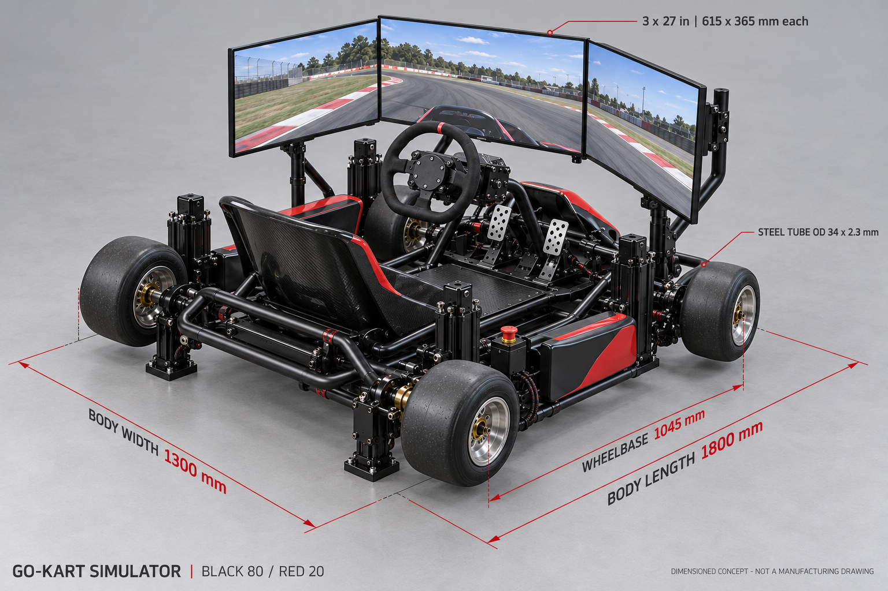
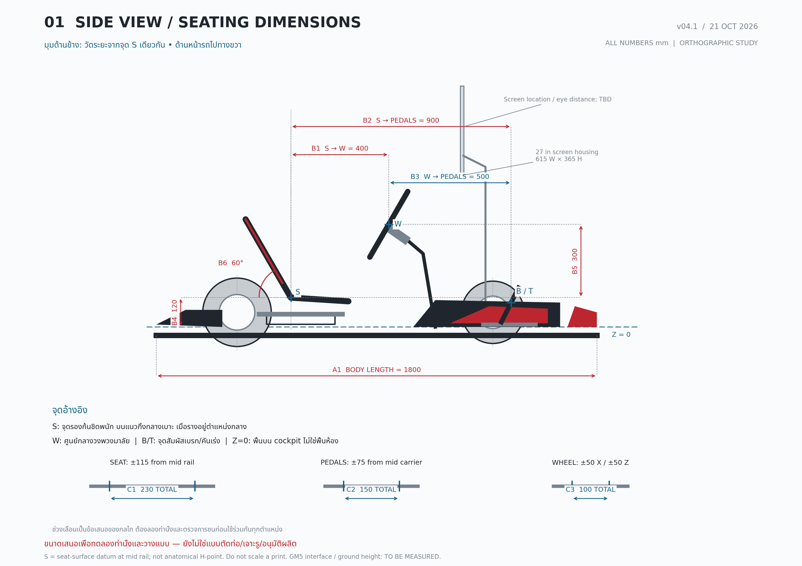
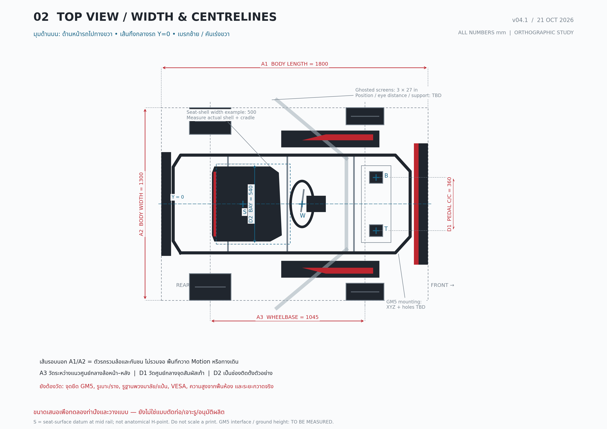

# Think of sim — ชุดสรุปคุยทีม Go-kart Simulator

ปรับปรุง 21 ตุลาคม 2026 (Asia/Bangkok) | เตรียมข้อมูลเสนอผู้บริหารประมาณ 29 ต.ค. 2026

เอกสารนี้สรุปจาก [Context หลัก v1.9](../Gokart_IDEA/PROJECT_CONTEXT.md) สำหรับคุยร่วมกัน ไม่ใช่การอนุมัติงบ แบบผลิต หรือผลทดสอบ เครื่องแรกต้องพร้อมนำไปโชว์ ส่วนวันโชว์และจำนวนเครื่องที่อนุมัติทำจริงยังต้องตกลง

## 1. สรุปพูดเปิดประชุม

เราจะพัฒนา Go-kart Simulator แบบ Modular เพื่อขายในไทย เริ่มวางแผนจากเครื่องแรกที่พร้อมโชว์ ใช้โครงท่อใหม่ รูปลักษณ์และท่านั่งโกคาร์ทจริง ล้อสี่ล้อ เบาะเลื่อน แยกเบรกซ้าย/คันเร่งขวา จอติดกับโครงเคลื่อนตาม และ PC ภายนอก ศึกษาสามจอ 27 นิ้วกับ GM5 เป็นฐาน แต่ยังไม่เลือกรุ่น/แบรนด์อุปกรณ์ขับ ต้องคุยหัวหน้าก่อน

Mark รับโครงสร้าง/Hardware และ Chin รับวงจรไฟฟ้า/อุปกรณ์ ขณะนี้มีแนวคิด ภาพ ข้อมูลวัสดุและมิติเริ่มต้น งบแบบช่วง และร่างเกณฑ์ตรวจรับแล้ว งานสำคัญต่อไปคือวัดและทดลองจริง เพื่อยืนยันว่า layout, น้ำหนัก, Motion, เกม และอุปกรณ์ทำงานร่วมกันได้ก่อนปล่อยแบบผลิต

## 2. สิ่งที่ยืนยันแล้ว กับสิ่งที่ยังเป็นข้อเสนอ

| เรื่อง | ข้อสรุป/สถานะ |
|---|---|
| เป้าหมาย | สินค้า Modular สำหรับไทย; เครื่องแรกพร้อมนำไปโชว์ ผู้ใช้ยืนยันแล้ว |
| โครงและท่านั่ง | สร้างโครงท่อใหม่ รูปลักษณ์โกคาร์ทจริง ล้อสี่ล้อ เบาะจริงพร้อม slider |
| การขับ | เบรกซ้าย คันเร่งขวา ศึกษา Active เฉพาะเบรก ไม่มีคลัตช์/ชุดเกียร์ในรุ่นแรก |
| จอ/PC | จอเคลื่อนตาม cockpit; สามจอ 27 นิ้วเป็นฐานศึกษา; PC ภายนอก |
| Motion | ใช้ GM5 เป็นฐานศึกษา ผู้ใช้แจ้งว่ามีเครื่อง แต่รุ่น/สภาพ/อุปกรณ์และความพร้อมทดลองยังไม่ตรวจ |
| Feeling | เข้าโค้ง → เบรก/เร่ง → เครื่องยนต์ → ขอบสนาม → ท้ายปัด ตามลำดับความสำคัญ |
| ทีม | Mark: โครงสร้าง/Hardware; Chin: วงจรไฟฟ้า/อุปกรณ์; เจ้าของเกม/ซอฟต์แวร์ยังต้องระบุ |
| แบรนด์/รุ่น | ยังไม่เลือก ต้องคุยหัวหน้า; Simagic ใช้อ้างอิงราคาเท่านั้น |
| สีและภาพ | ผู้ใช้ขอภาพสมจริง ไอโซเมทริก ดำ/แดง 80/20; เป็นทิศทางภาพ ยังไม่กำหนดวัสดุ/กระบวนการสีผลิต |
| ลูกค้า/คู่แข่ง | พักการศึกษาลูกค้า จุดขาย และราคา/รุ่นคู่แข่งในรอบนี้ ใช้ Simufy เป็นภาพอ้างอิง |
| ระบบลม | ออปชันอนาคต; ยังไม่เพิ่ม Bass shaker ตามแนวทางปัจจุบัน |
| เมื่อ GM5/เกมไม่ตอบโจทย์ | ศึกษาเพิ่มและเสนอผลกระทบก่อน ไม่เปลี่ยนระบบหรือลดขอบเขตเอง |
| วันที่ 29 ต.ค. | เป้าหมายพร้อมข้อมูลคุยผู้บริหาร ไม่ใช่กำหนดส่งเครื่องโชว์ |

## 3. ขนาดและท่านั่งที่จะใช้เริ่มวางแบบ

ใช้ [แผ่นระยะ v04.1 แบบ PDF สองหน้า](dimension-study/kart-dimension-study-v04.pdf) เป็นภาพอธิบายระยะหลัก แผ่นนี้วาดจากพิกัดที่กำหนดเดียวกัน มิติทั้งหมดเป็นข้อเสนอสำหรับ mock-up ยังไม่ได้วัดต้นแบบจริง

**จุดอ้างอิง:** S อยู่บนผิวเบาะบริเวณรองก้นชิดพนัก บนแนวกึ่งกลาง เมื่อรางอยู่กลางช่วง; W คือศูนย์กลางวงพวงมาลัย; B/T คือจุดสัมผัสเท้าบนเบรก/คันเร่ง; X ไปด้านหน้า และ Z=0 คือพื้นบน cockpit ไม่ใช่พื้นห้อง S ไม่ใช่ anatomical H-point

| รหัส | รายการ | ค่าตั้งต้น | สถานะ/ช่วงศึกษา |
|---|---|---:|---|
| A1 | ความยาวตัวรถรวมล้อ/กันชน | 1,800 มม. | เลือกในช่วงศึกษา 1,700–1,850; ไม่รวมจอ/ระยะ Motion |
| A2 | ความกว้างตัวรถรวมล้อ | 1,300 มม. | เลือกในช่วง 1,200–1,350; ไม่รวมจอ/ทางเดิน |
| A3 | ระหว่างศูนย์กลางล้อหน้า–หลัง | 1,045 มม. | Reference รถผู้ใหญ่ ไม่ใช่ layout simulator ที่ตรวจแล้ว |
| B1 | S ถึง W ในแนวนอน | 400 มม. | เริ่มลอง 350–450 |
| B2 | S ถึงจุดสัมผัสแป้นในแนวนอน | 900 มม. | เริ่มลอง 800–1,000 |
| B3 | W ถึงแป้นในแนวนอน | 500 มม. | คำนวณจาก 900−400; ไม่ใช่ 900 มม. |
| B4 | S สูงจากพื้น cockpit | 120 มม. | เริ่มลอง 100–160; รวม cradle/slider จริง |
| B5 | W สูงกว่า S | 300 มม. | เริ่มลอง 250–350; W จึงสูงจากพื้น cockpit 420 มม. ในตัวอย่าง |
| B6 | มุมแนวพนักจากแนวนอนด้านหลัง | 60° | เริ่มลอง 58–63° ต้องวัด shell จริง |
| C1 | ช่วงเลื่อนเบาะรวม | 230 มม. | ±115 จากกลาง; เป้าศึกษา 200–230 |
| C2 | ช่วงเลื่อนชุดแป้นรวม | 150 มม. | ±75 จากกลาง เป็นข้อเสนอกลไก |
| C3 | ช่วงปรับพวงมาลัยรวม | 100 มม./แกน | ±50 หน้า–หลัง และ ±50 สูง–ต่ำ; ต้องตรวจการล็อก/การชน |
| D1 | ศูนย์กลางจุดสัมผัสเท้าซ้าย–ขวา | 360 มม. | เริ่มลอง 320–400 |
| D2 | ช่องติดตั้งเบาะ/ชุดรอง | 540 มม. | ตัวอย่างในช่วง 520–560; shell ตัวอย่างกว้างสูงสุด 500 |
| — | วงพวงมาลัย | Ø310 มม. | กรอบทดลอง Ø300–320 ยังไม่เลือกรุ่น |
| — | กรอบจอตัวอย่างต่อจอ | 615 × 365 มม. | สามจอ 27 นิ้ว; เปลี่ยนเป็นมิติรุ่นจริงก่อนปล่อยแบบ |

**ข้อแก้ไขภาพเรนเดอร์อธิบายระยะ:** ภาพ AI v04 ในแชทวางเส้น 900 ต่อจากพวงมาลัย และเส้นพื้น/ขอบตัวรถบางจุดคลาดเคลื่อน ใช้ตารางและแผ่นพิกัด v04.1 นี้แทนในเรื่องระยะ โดย 400 และ 900 ต้องวัดจาก S เดียวกัน ไม่ใช้ภาพเรนเดอร์เป็นแบบเจาะ/ตัด

กรอบคนเป้าหมาย 150–190 ซม. และน้ำหนักสูงสุดเป้าหมาย 120 กก. ยังไม่ใช่พิกัดรับรอง ต้องทดลองหลายความยาวขา/ลำตัว/ความกว้างสะโพกและรองเท้า เบาะเดียวอาจไม่ครอบคลุมทุกคน อาจต้องมี insert หรือหลายไซซ์ตามผลจริง ช่วงกลไกทั้งหมดไม่ได้รับรองว่าใช้ร่วมกันได้ทุกปลายช่วง

## 4. วัสดุ โครง และวิธีประกอบ

ข้อเสนอสำหรับ Mark ตรวจแบบต่อ: เชื่อมแกนโครงหลักบนจิ๊ก แล้วขันโมดูลเบาะ แป้น พวงมาลัย ขาจอ ตัวถังและพื้นให้ถอด/ปรับได้ เครื่องแรกยังไม่เสนอแยกรอยต่อกลางโครงหลักหากไม่จำเป็น

| ส่วน | วัสดุ/ขนาดเริ่มศึกษา | จุดที่ต้องตรวจ |
|---|---|---|
| โครงรอบ cockpit | STK400 / JIS G3444 ท่อกลม OD 34 × 2.3 มม. | โหลด ดัดท่อ รัศมี/ความรี ความหนาจริงและเกรดล็อต |
| คานรับเบาะ/แป้น/จุด Motion | STKR400 / JIS G3466 กล่อง 40 × 40 × 2.3 มม. | ช่วงคาน การบิด โหลดเยื้อง จุดต่อและความล้า |
| แท่นแป้น/พวงมาลัยและค้ำ | SS400 เพลตเริ่ม 4–6 มม. | พับขอบ/ค้ำ ลดช่วงยื่น แรงเบรกและ torque รุ่นจริง |
| Adapter Motion | เพลตเหล็กเริ่ม 6–8 มม. พร้อมคานรอง | ยังไม่มี hole pattern/แนวแรง/torque ที่ตรวจสำหรับโครงใหม่ |
| ขาจอ | เริ่มกล่อง 40 × 40 × 2.3 มม. มีค้ำสองระนาบ | มวลจอ แขนยื่น การสั่น และถอดตั้งคืน |
| เบาะ/cradle | shell จริง + support plate/spacer แข็ง + cradle เหล็กเริ่ม 3–4 มม. + slider คู่ | แนบผิว ไม่ดึง shell ให้บิด ไม่ขัน shell แบน ๆ ลงรางโดยตรง |
| พื้น | Aluminium 5052-H32 เริ่ม 2–3 มม. มีคานรองและผิวกันลื่น | แรงเหยียบ/การขึ้นลง ขอบคม ระยะคานและรอยต่อเหล็ก–อะลูมิเนียม |
| ตัวถัง/ฝาครอบ | ABS หรือ PC/ABS เริ่ม 3–4 มม.; เทียบไฟเบอร์กลาสได้ | งานผิว ซ่อม/ถอด ความร้อนและเงื่อนไขสถานที่ |
| H2C | ชิ้นต้นแบบรูปทรง ฝาตกแต่ง ป้าย ไกด์สาย/แม่แบบ | ไม่ใช้ชิ้นพิมพ์ที่ยังไม่พิสูจน์รับผู้ขับ Motion จอ หรือ FFB |

ตัวอย่างน้ำหนักเฉพาะโครงจากความยาววัสดุประมาณ **22.7–32.9 กก.** สอดคล้องคร่าว ๆ กับกรอบเดิม 25–35 กก. แต่ยังไม่มี CAD หรือการชั่งยืนยัน น้ำหนัก cockpit พร้อมอุปกรณ์เดิมประมาณ **85–135 กก.** และทั้งชุดรวม Motion/ฐานประมาณ **120–175 กก.** ไม่รวมคน/PC ต้องแจกแจงว่าส่วนใดเคลื่อนจริงก่อนคำนวณโหลด

เส้นทางแรงหลัก: คน/เบรก/FFB/จอ → cradle/แท่น/คาน → โครงหลัก → interface Motion อย่าส่งแรงผ่านตัวถังหรือแผ่นพื้นบาง จุดขันทะลุท่อพิจารณา crush sleeve/เพลตรองที่ตรวจแล้ว ไม่ตั้งเกรด/จำนวน/torque ของน็อตทุกจุดจากค่ากลาง

ลำดับทำงาน: วัด interface → mock-up → block CAD/มวล/CG → ตรวจโหลด/รอยต่อ → ทำจิ๊ก → ดัด/เข้าปากท่อ/เชื่อมตามกระบวนการ → ประกอบแห้งก่อนสี → ทำผิว/เดินสาย/บันทึกแรงขัน → โหลดจำลอง → ทดลองคน → ซ้อมโชว์/ขนย้าย

รายละเอียดและแหล่งวัสดุ: [รายงานท่านั่ง วัสดุ และการประกอบ](seating-materials-assembly-th.md)

## 5. ระบบไฟ อุปกรณ์ และซอฟต์แวร์

- ผู้ขับ → ฐานพวงมาลัย/แป้น → USB → เกมบน PC
- เกม → Force Feedback → ฐานพวงมาลัย
- เกม → telemetry → SimHub Motion → controller/GM5 → actuator
- PC/การ์ดจอ → ภาพสามจอ; PC อยู่ภายนอก มีสายเผื่อการเคลื่อนและ strain relief
- Active brake ถ้าเลือก ต้องตรวจเส้นทาง effect/ซอฟต์แวร์ของรุ่นนั้นแยก ไม่ถือว่า SimHub ส่งได้ครบทุกฟังก์ชัน
- Chin จัดผังไฟ ตารางโหลด USB การระบายความร้อน สายดิน จุดตัดไฟ E-stop และวิธีหยุด Motion/FFB/Active แยกอุปกรณ์ ไม่ถือว่า E-stop ของ GM5 ตัดทุกอย่าง

KartKraft และ Kart Racing Pro เป็นเกมที่จะเปรียบเทียบ ยังไม่เลือกเกมสุดท้าย ต้องทดสอบ telemetry/Feeling/สามจอจริง และสิทธิ์ใช้สาธิต/เชิงพาณิชย์แยกจากไลเซนส์ส่วนบุคคล ข้อมูลเดิมของ Kart Racing Pro ระบุไม่มี AI ออฟไลน์ จึงเป็นปัจจัยเลือกเกม ไม่ใช่ข้อสรุปว่าเหมาะกับงานโชว์แล้ว

GM5 เป็น 3DOF pitch/roll/heave ไม่มี yaw/sway/surge แยก การเอียงใช้สร้าง cue เข้าโค้ง/เบรกได้ แต่ไม่สร้างแรงเหวี่ยงต่อเนื่องหรือท้ายปัดจริงครบถ้วน ต้องประเมิน Feeling จากผลทดลอง

## 6. ข้อมูล GM5 ที่ต้องแจ้งทีม

[หน้าผู้ผลิต](https://thermaltake.com/products/gm5-3dof-motion-system) เป็นข้อมูลสเปก ไม่ใช่ผลทดสอบของเรา: payload 300 กก., ชุดหนัก 27 กก., stroke 100 มม., ความเร็วสูงสุด 250 มม./วินาที, ความเร่งสูงสุด 0.4g และกำลังไฟสูงสุด 1.2 kW ไม่ใช้ตัวเลขสูงสุดทุกตัวพร้อมกันโดยไม่มีหลักฐาน

เปิด [คู่มือ GM5](https://file.thermaltake.com/file/qig/GM5_User_Manual.pdf) ได้แล้ว: **เมื่อโหลดรวมเกิน 200 กก. จำกัดการเล่นต่อเนื่องไม่เกิน 4 ชั่วโมง** คู่มือไม่ได้ระบุช่วงพักสำหรับใช้งานซ้ำทั้งวัน หาก cockpit เคลื่อนจริง 85–135 กก. ร่วมผู้ขับ 120 กก. จะเป็น 205–255 กก. ก่อนแจกแจงส่วนอื่น จึงต้องยืนยัน duty cycle/ช่วงพักก่อนออกโชว์

ภาพเสาอยู่ชิดโครงเป็นทิศทางแนวคิด คู่มือมีตัวอย่าง connector/M8 กับ cockpit ของผู้ผลิต แต่ยังไม่มีมิติ interface และการตรวจโครงใหม่ ห้ามใช้ขนาด 520 × 485 มม. บนหน้าเว็บเป็น footprint ตัวรถ หรืออนุมานว่าจุดยึดตามภาพใช้กับ GM5 ได้แล้ว

## 7. งบสำหรับคุยหัวหน้า

หน่วยบาท THB หนึ่งเครื่อง เป็นประมาณการโครงการ ไม่ใช่ราคาขอซื้อ ยังไม่ล็อกแบรนด์ เบรกปกติเป็นตัวเลือกเปรียบเทียบ ไม่ใช่การอนุมัติลดสเปกจาก Active

| หมวด | เบรกปกติ | Active brake หนึ่งแป้น |
|---|---:|---:|
| เครื่องรวมโครง/ตัวถัง/เบาะ/อุปกรณ์ขับ/จอ/ไฟ/ประกอบ/ชุดขนย้าย ไม่รวม Motion/PC | 162,000–265,000 | 192,000–300,000 |
| พัฒนา ออกแบบ mock-up จิ๊ก แก้แบบ ทดสอบ/เอกสาร | 80,000–150,000 | 80,000–150,000 |
| PC และอุปกรณ์จำเป็น | 50,000–80,000 | 50,000–80,000 |
| รวมฐาน B | 292,000–495,000 | 322,000–530,000 |
| **รวมสำรอง 20% ของ B** | **350,400–594,000** | **386,400–636,000** |

กรณี Active และ GM5 เดิมพร้อมใช้ เสนอใช้ประมาณ **520,000 บาท + รายการรอราคา** เป็นจุดเริ่มคุย ปัดจากค่ากลาง 511,200 บาท ไม่ใช่เพดานรับประกัน

รายการรอเติม: M_new = เงินซื้อ/ซ่อม/เติม Motion จริง; L = เกม/สิทธิ์โชว์/ซอฟต์แวร์; T = ภาษี/นำเข้า/ขนส่งเฉพาะส่วนที่ยังไม่รวม สูตรตั้งงบเมื่อเผื่อเท่ากันคือ **1.20 × (B + M_new + L + T)** ห้ามเผื่อหรือบวก VAT ซ้ำ งบเดินทาง บูธ เจ้าหน้าที่และกิจกรรมโชว์แยกเมื่อทราบงาน

งบพัฒนารวมต้นทุนเวลาภายในสมมติ 240–360 ชม. รวมสองคน × 250 บาท/ชม. เป็นเงิน 60,000–90,000 และวัสดุทดลอง/จิ๊ก/แก้/ตรวจ 20,000–60,000 อัตรานี้ยังไม่ใช่ค่าจ้างที่ตกลง แยกต้นทุนทั้งหมดจากเงินสดต้องจ่ายใหม่ สำหรับผลิตขายต้องนับราคาทดแทน GM5 แม้เครื่องโชว์ใช้ของเดิม

แหล่งราคาที่ตรวจมีข้อจำกัดสต็อก/วันที่ราคา และยังไม่มี BOM หรือราคาโรงงานครบ รายละเอียดเก้าหมวดและวิธีนับอยู่ใน [แผนพร้อมโชว์](show-ready-plan-th.md) ยังตั้งราคาขายจากช่วงนี้ไม่ได้

## 8. แบ่งงานและสิ่งส่งมอบ

| ผู้รับผิดชอบ | ขอบเขต | งานต่อที่เสนอ |
|---|---|---|
| **Mark — ยืนยันแล้ว** | โครงสร้าง/Hardware | วัดท่านั่ง/เบาะ/ราง/GM5, block CAD, ช่วงปรับ, weight budget/CG, จุดรับแรง, ขาจอและขนย้าย, วัสดุ/แบบ/จิ๊ก/BOM เครื่องกล |
| **Chin — ยืนยันแล้ว** | วงจรไฟฟ้าและอุปกรณ์ | รายการอุปกรณ์ 2–3 ระดับราคา/มิติติดตั้ง, ผังไฟ/USB, power budget, stop matrix ของแต่ละอุปกรณ์, สาย/กล่อง/ความร้อน, BOM ไฟฟ้า |
| **เกม/ซอฟต์แวร์ — ยังต้องระบุ** | เกม/telemetry/Motion profile/benchmark/backup | ทดลอง GM5 กับเกมจริงและสรุป effect ที่ทำได้/ข้อจำกัด เสนอให้ Chin ประสานได้แต่ยังไม่ถือว่ามอบหมายแล้ว |
| เจ้าของโครงการ/หัวหน้า | ขอบเขต งบ แบรนด์ อนุมัติและสถานที่ | ยืนยันอุปกรณ์/งบ เวลา/สถานที่โชว์ ชั่วโมงทีม ผู้ตรวจและผู้อนุมัติปล่อยเครื่อง |
| ผู้ตรวจเครื่องกล/ไฟฟ้า — ยังต้องแต่งตั้ง | ตรวจแบบ วิธีทดสอบ และผลก่อนใช้กับคน | กำหนด load cases/เกณฑ์เสียรูป การหยุดและไฟฟ้าจากอุปกรณ์จริง ไม่ให้ผู้ทำแบบรับรองตนเองโดยอัตโนมัติ |

ติดตามงานจริงและสถานะใน [tasks.md](tasks.md) บันทึกข้อสรุปใหม่ใน [decisions.md](decisions.md) ทำผ่าน branch/PR ไม่ merge main โดยไม่มีคำสั่ง

## 9. เกณฑ์พร้อมโชว์ที่เสนอครบ 16 ด้าน

ทั้งหมดเป็นร่าง v0.1 ยังไม่มีผลทดสอบ ให้ผู้ตรวจยืนยันวิธีและค่าที่เกี่ยวข้องกับความปลอดภัยก่อนทดสอบจริง

| รหัส | ตรวจอะไร | เกณฑ์/หลักฐานตั้งต้น |
|---|---|---|
| A01 | ท่านั่ง/การเข้าถึง | อย่างน้อย 5 คน ครอบคลุมใกล้ 150/170/190 ซม. เท่าที่มีจริง บันทึกช่วงที่ยังไม่ตรวจ |
| A02 | ปรับและล็อกเบาะ/แป้น/วง | ปรับ/ล็อก 20 รอบ ไม่เลื่อน/คลายภายใต้เงื่อนไขที่ผู้ตรวจอนุญาต |
| A03 | โครง/จุดยึด/โหลด | แบบและ load plan ผ่าน ตรวจด้วยโหลดจำลองก่อนคน; เกณฑ์เสียรูป/โหลดต้องกำหนดก่อน |
| A04 | ระยะเคลื่อน/สาย/ผู้ชม | ทดสอบขอบช่วงที่อนุญาต ไม่ชน หนีบ ดึงสาย มีขอบเขตกั้นผู้ชม |
| A05 | ระบบไฟ | ผัง/ขนาดสาย/สายดิน/การป้องกันและค่าตรวจโดยผู้ตรวจไฟฟ้า |
| A06 | E-stop/สัญญาณ/ไฟดับ | ตรวจ Motion/FFB/Active แยก 10 รอบกระจายเงื่อนไข ไม่เคลื่อนเองหลัง reset; เวลา/ระยะหยุดต้องกำหนด |
| A07 | จอ/ขาจอ | ไม่เลื่อน/คลาย/ชน ภาพอ่านได้กับผู้ทดสอบอย่างน้อย 5 คนในโปรไฟล์ที่ผ่าน |
| A08 | ภาพ/เสียง/การตอบสนอง | ฉากหนัก 30 นาที เฉลี่ย ≥60 fps, 1% low ≥45 fps ไม่มีจอดับ/USB หลุด; เริ่มประเมิน 5760×1080 แล้วทดสอบใหม่หากเปลี่ยนความละเอียด |
| A09 | Feeling | ผู้ขับจริง ≥3 คน เปิด/ปิด Motion เงื่อนไขเดียวกัน เข้าโค้งและเบรก/เร่งเฉลี่ยแต่ละด้าน ≥3.5/5 ความสบาย ≥4/5 บันทึกผู้หยุดทุกคน |
| A10 | Active brake ถ้าเลือก | แยกติดตั้ง/แรง/calibration/การหยุด/effect ตามรุ่นจริงผ่าน |
| A11 | ความเสถียร | รวม ≥20 ชม. มีวันจำลองโชว์ 8 ชม. รวมพัก และ ≥30 session ×5–10 นาที; duty ต้องผ่านข้อจำกัด GM5 ก่อน ไม่มี fault ค้าง |
| A12 | งานผิว/การเก็บสาย | ไม่มีคม/สายเปลือย/ปลั๊กห้อยในทางเดิน มีฉลากและ strain relief |
| A13 | ขนย้าย/ตั้งคืน | ครบ 2 รอบ เป้าตั้งพร้อมใช้ ≤60 นาที/รอบ ใช้อุปกรณ์ยก/รถเข็นตามมวลจริง ไม่บังคับสองคนยกทั้งเครื่อง |
| A14 | เจ้าหน้าที่ | อย่างน้อย 2 คนทำขั้นตอนคนละรอบ; cold start ≤10 นาที เปลี่ยนคน ≤3 นาทีในช่วงที่ทดสอบแล้ว |
| A15 | สถานที่/สิทธิ์ | ตรวจพื้น/พื้นที่/ไฟ/ทางเข้า/ผู้จัดและสิทธิ์ซอฟต์แวร์ตามการใช้จริง |
| A16 | เอกสาร/ปล่อยเครื่อง | as-built, BOM, versions, wiring, backup, คู่มือ/ข้อจำกัด/checklist/บำรุงครบ ผู้ตรวจและผู้อนุมัติที่แต่งตั้งลงชื่อ |

ปัญหาอันตรายให้หยุดและกั้นเครื่อง ปัญหาฟังก์ชันหลัก/ความเสถียรยังไม่ผ่านให้คงสถานะไม่พร้อมโชว์ งานผิวเล็กน้อยอาจรับพร้อมรายการแก้ไขได้เมื่อผู้มีอำนาจลงชื่อ การผ่านต้นแบบไม่เท่ากับรับรองผลิตภัณฑ์พร้อมขาย

## 10. ลำดับพัฒนาและข้อมูลที่ต้องมีสำหรับประชุม

| จุดตรวจ | ผลลัพธ์ก่อนเดินต่อ |
|---|---|
| 1 ตรวจ GM5/เกมและสิทธิ์ | คู่มือ/รุ่น/สภาพ/interface, telemetry ที่ใช้ได้ และข้อจำกัด duty |
| 2 Mock-up/มวล/layout | ท่านั่งหลายคน ช่วงปรับที่ใช้ได้ block CAD, มวล/CG และเส้นทางแรง |
| 3 เลือกอุปกรณ์/ตรวจแบบ/งบ | หัวหน้าเลือกตัวเลือกจาก BOM/ราคา/lead time ผู้ตรวจผ่านแบบก่อนปล่อยผลิต |
| 4 ผลิต/ประกอบ/ตรวจไม่มีคน | ตรวจมิติ รอยเชื่อม จุดต่อ สาย E-stop ระยะกวาดและโหลดจำลอง |
| 5 ทดลองคน/ปรับ/ซ้อม | Feeling, จอสั่น, endurance, สถานที่, ฝึกเจ้าหน้าที่ และขนย้าย |
| 6 ปล่อยเครื่อง | ปิดปัญหาสำคัญ เอกสารครบและผู้ตรวจลงชื่อ แล้วจึงพิจารณาเครื่องสอง/ขาย |

กรอบเวลาเดิม 8–12 สัปดาห์เป็นสมมติฐานเมื่อทีมลงงานได้ใกล้เต็มเวลาและอุปกรณ์พร้อม ต้องประเมินใหม่สำหรับงานพร้อมโชว์จากชั่วโมงจริง lead time การแก้แบบ และข้อจำกัด GM5 ยังไม่ใช่กำหนดส่ง

สำหรับการคุยประมาณ 29 ต.ค. ควรได้: ข้อมูลเครื่อง GM5/มิติสำคัญ, layout เริ่มต้น, ตัวเลือกอุปกรณ์และ BOM ชุดแรก, ช่วงงบพร้อมรายการรอราคา, แผนทดสอบ/ความเสี่ยง และคำถามตัดสินใจ ไม่จำเป็นต้องมีต้นแบบเสร็จในวันนั้น

## 11. ความเสี่ยงที่ต้องให้ทีมเห็นตรงกัน

| ความไม่แน่นอน | ผลกระทบ | ข้อมูล/งานที่ลดความไม่แน่นอน |
|---|---|---|
| เสา GM5 ชิดโครงตามภาพไม่ได้ | layout เปลี่ยน | วัด interface และตรวจแนวติดตั้งก่อนล็อกโครง |
| โหลด/CG และ duty ไม่เหมาะ | Motion/เวลาสาธิตไม่ตามเป้า | ชั่งมวลเคลื่อน ตรวจโหลดแต่ละจุดและเงื่อนไขพัก |
| สามจอสั่น/แขนยื่น | ภาพ/ความล้าและจุดยึด | รุ่นจอจริง ขาจอมีค้ำ และทดสอบพร้อมโหลด |
| เกม/telemetry ไม่ครบ | Feeling บางด้านทำไม่ได้ | ทดลองก่อนกล่าวอ้างและรายงาน effect ตามผลจริง |
| Active/อุปกรณ์ไม่พร้อมหรือแยกไม่ได้ | งบ/กำหนดการเปลี่ยน | ตรวจของในชุด สต็อก/lead time และตัวเลือกโดยยังไม่เปลี่ยนสเปกเอง |
| งบช่วงกว้าง/ราคายังไม่ครบ | ตัดสินใจซื้อไม่ได้ | BOM ฐานภาษีเดียวกัน แยกเงินสด/แรงงานภายใน/ของเดิม |
| ชั่วโมงทีม/ผู้ตรวจ/สถานที่ยังไม่กำหนด | ประเมินวันโชว์ไม่ได้ | จัดคน เวลา และสถานที่พร้อมเกณฑ์ปล่อยเครื่อง |

## 12. คำถามให้หัวหน้าและทีมตัดสินใจ

1. โชว์วันไหน ที่ไหน กี่วัน/กี่ session ต่อวัน ให้ใครทดลอง และใครเป็นเจ้าหน้าที่?
2. อนุมัติทำหนึ่งเครื่องก่อนหรือจำนวนใด และใช้ผลอะไรตัดสินใจเครื่องสอง?
3. เลือกอุปกรณ์ระดับ/แบรนด์ใด Active brake เป็นชุดหลักหรือออปชัน?
4. GM5 ที่มีรุ่นใด ของครบหรือไม่ พร้อมให้ทดลองเมื่อไร และใครยืนยัน?
5. ยอมรับกรอบงบใด แยกเครื่อง พัฒนา PC และรายการรอราคา รวมภาษีอย่างไร?
6. Mark/Chin ลงได้กี่ชั่วโมงต่อสัปดาห์ ใครรับเกม/ซอฟต์แวร์ ใครตรวจเครื่องกล/ไฟฟ้า และใครอนุมัติปล่อยเครื่อง?
7. ยอมรับร่างเกณฑ์ตรวจรับใด ต้องปรับเป้าภาพ/Feeling/เวลาทำงานตรงไหนก่อนทดสอบ?
8. หาก GM5/เกมไม่ผ่าน ใครรวบรวมผลศึกษาและนำทางเลือกพร้อมงบ/เวลาให้ตัดสินใจ?

วาระประชุมเสนอ 30 นาที: เป้าหมาย/สถานะ 5 นาที → ภาพ/ท่านั่ง/ระบบ 10 นาที → งบ/ความเสี่ยง 5 นาที → ตัดสินใจ/คน/สิ่งส่งมอบ 10 นาที จบประชุมให้บันทึกข้อสรุปพร้อมผู้รับผิดชอบ วันที่ต้องได้ข้อมูล และหลักฐานการอนุมัติ แยกจากข้อเสนอที่ยังไม่ได้ข้อสรุป

## 13. ไฟล์ที่ใช้เปิดคุย

- [ชุดสรุปนี้ — Word](team-brief-th.docx) / [PDF](team-brief-th.pdf)
- [ภาพแนวคิด v03](../Gokart_IDEA/Concepts/kart-concept-v03-isometric.png)
- [แผ่นระยะ v04.1 PDF สองหน้า](dimension-study/kart-dimension-study-v04.pdf) / [มุมข้าง PNG](dimension-study/01-side-dimensions.png) / [มุมบน PNG](dimension-study/02-top-dimensions.png)
- [ตารางพิกัดและค่าตั้งต้น JSON](dimension-study/layout-v04.json) / [คำอธิบายและรายการวัด](dimension-study/README.md)
- [รายงานเครื่องกล](seating-materials-assembly-th.md) / [Word](seating-materials-assembly-th.docx) / [ตาราง mock-up CSV](seating-mockup-measurements.csv)
- [งบและเกณฑ์พร้อมโชว์ฉบับเต็ม](show-ready-plan-th.md)
- [ข้อเสนอผู้บริหาร](management-proposal-th.md) / [Word](management-proposal-th.docx)
- [รายการงาน](tasks.md) / [บันทึกข้อสรุป](decisions.md) / [วิธีทำงานร่วมกัน](team-workflow.md)
